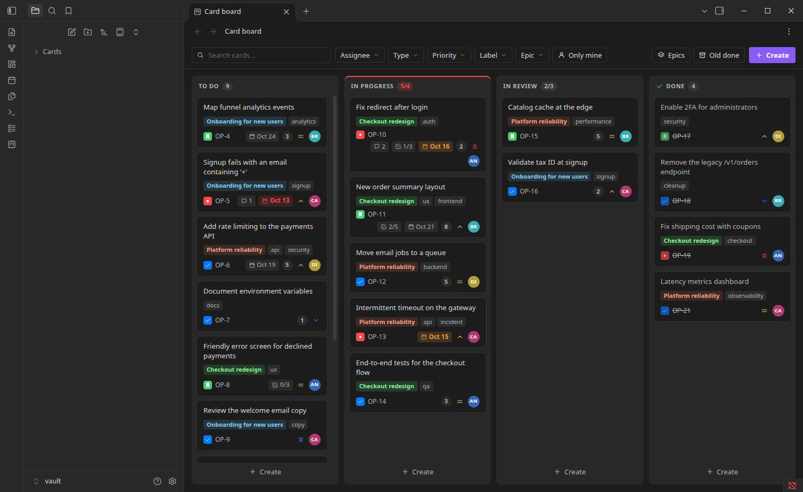
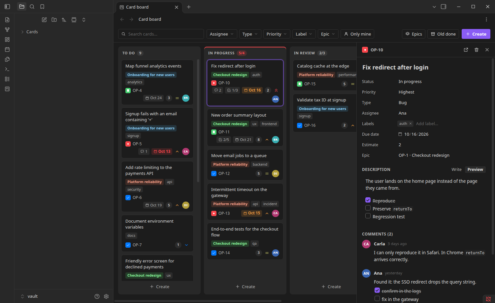
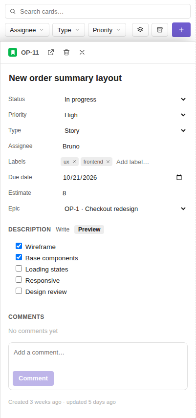

# Obsidian Projects

**A.I. first project management in real time.**

A Jira-style card board inside Obsidian, with a CLI (`oprojects`) and an MCP server (`oprojects-mcp`) so that AI agents can
work on the same board.
Everything runs locally. **Every card is a Markdown note** with frontmatter: searchable, linkable (`[[OP-12]]`),
versionable and editable by hand. Changes made from anywhere (the board, the CLI, an agent, a sync client) show up
live on the open board.



| Details and comments (Obsidian, dark theme) | Phone layout (400 px) |
| --- | --- |
|  |  |

## Installation

Requires Node ≥ 20.

```bash
npm install
npm run build
npm run install:vault -- "/path/to/your/vault" --enable   # copies main.js, manifest.json, styles.css
```

Open Obsidian → *Settings → Community plugins* → enable **Projects** (if you did not use `--enable`).
Use `--link` instead of copying while developing (`npm run dev` rebuilds; reload the plugin).

CLI, from any folder inside a vault:

```bash
ln -s "$PWD/packages/cli/dist/oprojects.cjs" ~/.local/bin/oprojects && chmod +x packages/cli/dist/oprojects.cjs
oprojects init --prefix OP --me "Your Name"
oprojects add "Fix login" -t bug -p high --due +3d
oprojects board
```

### From a release

Each [release](https://github.com/GustavoEklund/obsidian-projects/releases) carries `main.js`, `manifest.json` and
`styles.css`: put them in `<vault>/.obsidian/plugins/obsidian-projects/`, reload Obsidian and enable **Projects**
(the [BRAT](https://github.com/TfTHacker/obsidian42-brat) plugin can install and update it from this repository
too). The CLI is the single file `oprojects.cjs` (Node ≥ 20): make it executable and put it on your `PATH` as
`oprojects`. `SHA256SUMS.txt` lists the checksums.

Without `init` it works with the defaults (`Cards` folder, `OP` key). The vault is found through `--vault`,
`$OPROJECTS_VAULT`, or by walking up the folders until a `.obsidian` is found.

## What a card looks like

```markdown
---
key: OP-12
title: Fix redirect after login
status: doing          # column id
type: bug              # task | story | bug | epic
priority: high         # highest | high | medium | low | lowest
assignee: Ana
labels: [auth, backend]
due: 2026-10-20
estimate: 3
parent: OP-1           # epic
rank: X                # position in the column (fractional index)
created: 2026-10-01T10:00:00.000Z
updated: 2026-10-02T10:00:00.000Z
---
The description is the body of the note.

- [x] Reproduce
- [ ] Regression test     ← becomes the 1/2 counter on the card

## Comments

> [!comment|k3f9a,2026-10-14T17:02:00.000Z] Ana · 2026-10-14 14:02
> Only reproduces in Safari.
> - Markdown works in here
```

**Comments** live at the end of the note itself, in the `## Comments` section, one Obsidian *callout* per comment
(the part after `|` holds the id and the time; the title is what people read). That is why they also show up as boxes
in the note, are searchable, and can be edited by hand. A hand-written `> [!comment] Someone` without metadata counts too.
Editing the description never touches the comments section, and commenting only changes `updated` in the frontmatter.

Fields you add by hand and YAML comments are preserved on every edit.
The file is always `Cards/KEY-n.md`; moving or renaming the note does not break the card (the `key` is what counts).

## Plugin

- **Board** with drag and drop between and within columns, WIP limits (turn red when exceeded), overdue/upcoming due dates,
  checklist progress, epic, labels, avatar and priority.
- **Details panel**: every field is editable and saves by itself. The description opens **rendered (Preview)**:
  click the text to edit (`Esc` or clicking away saves and goes back; selecting text to copy does not open the editor).
  Checklist checkboxes work right in the preview, in the description and in comments, and write to the note.
  Wide tables scroll inside themselves and images scale down; nothing widens the panel.
  **Resizable**: drag the left edge (or focus it and press `←/→`; `Shift` moves faster), double-click restores the default
  (420 px). The width is saved with the layout, with a 300 px minimum and a minimum space left for the board.
- **Comments**: a thread in the panel (author, time, rendered Markdown), edit/delete, `Ctrl+Enter` posts,
  a draft per card and a 💬 counter on the card. The author is your name in *Settings → Projects → My name*.
- **Filters**: search (accent-insensitive, over title/key/label/description), assignee, type, priority, label, epic, "only mine".
  They are saved with the workspace layout.
- **Quick create** at the bottom of each column: `Enter` creates and stays open; first line = title, the rest = description.
- **Keyboard**: `Enter` opens · `Alt+←/→` changes column · `Alt+↑/↓` reorders · `/` searches · `c` creates · `Esc` closes.
  Right click: move, priority, assign to me, copy key/link, delete.
- **Commands**: *Open card board*, *Create card*, *Go to card…*.
- Responsive by **pane width** (not window width): works side by side with a note, in a split view, or on a phone.
- Theme: uses Obsidian's variables, so it follows any light/dark theme. The interface is available in English and
  Brazilian Portuguese (it follows Obsidian's language).

Settings: folder, project key, your name, members, hiding old done cards (14 days by default),
and columns (name, "done", WIP, order). Each column's `id` is stable: renaming one does not touch any card.

## CLI

```
oprojects add <title…> [-t type] [-p priority] [-s column] [-a assignee] [-l a,b] [--due date] [--estimate n] [--parent KEY] [--body text|-]
oprojects list|ls [-s column] [-t type] [-p priority] [-a name|none|me] [-l label] [--parent KEY] [-q text] [--mine] [--all]
oprojects board [--epics]            # kanban in the terminal, columns side by side
oprojects show <key>                 # the key can be OP-12 or just 12; lists the comments with their ids
oprojects comment|c <key> <text…|->  [--author name]        # comment ("-" reads from stdin)
oprojects comment <key> --edit <id> <text…|->   |   --rm <id>
oprojects move|mv <key> <column> [--before KEY | --after KEY]
oprojects edit <key> [--title …] [-p …] [--add-label x] [--rm-label y] [--due none] …   # "none" clears the field
oprojects rm <key>                   # goes to the vault's .trash/ (recoverable)
oprojects open <key>                 # opens it in Obsidian (obsidian://)
oprojects init | config
```

Global options in any position: `--vault <path>`, `--json`, `--no-color`. Dates accept `today`, `tomorrow`, `+3d`, `+2w`.
Exit codes: `0` ok · `1` validation/not-found error · `2` incorrect usage. With `--json` the output is stable for scripts.

## MCP server

`oprojects-mcp` lets an AI agent (Claude Code, Claude Desktop, Cursor, any MCP client) work on your board: list and
filter cards, read one with its comments, create, update, move, comment, delete. It is written in Rust, runs locally and
is built to be small: **about 5 MB of memory when idle, 11 MB with 2,000 cards indexed, a 3 MB binary**, and it answers
in milliseconds. What it changes shows up live on an open board, and the other way round.

### Install

Download the archive for your platform from the [latest release](https://github.com/GustavoEklund/obsidian-projects/releases/latest)
(`oprojects-mcp-<version>-<platform>`: Linux x64 and arm64, both static; macOS Intel and Apple Silicon; Windows x64 and arm64),
unpack it and put `oprojects-mcp` on your `PATH`. On macOS the binary is not signed: run
`xattr -d com.apple.quarantine oprojects-mcp` once. To build it yourself, run `asdf install` (Rust comes from
`.tool-versions`) and `npm run build -w packages/mcp`; the binary is `packages/mcp/target/release/oprojects-mcp`.

### Connect an agent

```bash
claude mcp add obsidian-projects -- oprojects-mcp --vault "/path/to/your/vault"
```

For a client that reads a JSON configuration (Claude Desktop, Cursor):

```json
{ "mcpServers": { "obsidian-projects": { "command": "oprojects-mcp", "args": ["--vault", "/path/to/your/vault"] } } }
```

Without `--vault` it uses `$OPROJECTS_VAULT`, or the nearest folder above the current one that has an `.obsidian` folder.
`oprojects-mcp --help` prints these commands.

### Tools

| Tool | What it does |
| --- | --- |
| `board_summary` | Cards per column, WIP limits, overdue and unassigned counts. A good first call. |
| `list_cards` | Cards in board order. Filters: `status`, `type`, `priority`, `assignee` (`me`, `none` or names), `labels`, `parent`, `text`, `include_archived`; `limit` (default 50, at most 200). |
| `get_card` | One card with its description and comments (with their ids). |
| `create_card` | A new card at the bottom of a column. `title` is required; `due` accepts `YYYY-MM-DD`, `today`, `tomorrow`, `+3d`, `+2w`. |
| `update_card` | Changes fields; an omitted field is kept, `null` clears `assignee`, `due`, `estimate` or `parent`. |
| `move_card` | Moves a card to a column (id or name), optionally before or after another card. |
| `delete_card` | Moves the note to the vault's `.trash` (recoverable). |
| `add_comment`, `edit_comment`, `delete_comment` | A thread per card. Comments are signed with `author`, else `--author`, else "Agent". |

Answers are compact text, one line per card, because what the agent reads costs context. A mistake comes back as a tool
error that says what would be valid (for example the columns of the board), so the agent can correct itself.

### Options

| Option | |
| --- | --- |
| `--vault <path>` | The vault to serve. |
| `--read-only` | Registers only the three tools that read: the agent cannot change anything. |
| `--author <name>` | Signs the comments the agent adds ($`OPROJECTS_AUTHOR`; default "Agent"). |
| `--http` | Serves over HTTP instead of stdin/stdout, so one server can be shared by several clients (below). |
| `--port <n>` | With `--http`: the port (default 8765; `0` picks a free one). |
| `--token <secret>`, `--token-file <path>` | With `--http`: the bearer token ($`OPROJECTS_MCP_TOKEN`). |

`OPROJECTS_LOG=debug` prints diagnostics on stderr; a healthy server is silent.

### One server for several clients (HTTP)

```bash
oprojects-mcp --http --token-file ~/.config/oprojects-mcp.token --vault "/path/to/your/vault"
claude mcp add --transport http obsidian-projects http://127.0.0.1:8765/mcp \
  --header "Authorization: Bearer $(cat ~/.config/oprojects-mcp.token)"
```

It listens on `127.0.0.1` only and requires the token on every request (compared in constant time). Requests whose `Host`
or `Origin` is not local are refused, which stops a web page from reaching it (DNS rebinding). With no token it generates
one and prints it once. The details are in [SECURITY.md](SECURITY.md) and
[packages/mcp/DESIGN.md](packages/mcp/DESIGN.md).

### How it stays faithful to the plugin and the CLI

The three read and write the same notes, so they must agree on every format. `packages/core` (TypeScript) is the
reference implementation; `packages/mcp` is a port of it, proved against a corpus of about 9,000 cases generated from the
TypeScript code (`npm run conformance`). CI fails if the corpus is stale, so a behavior change in the TypeScript core
cannot land without the Rust server being made to match. Notes written by one are read back by the other in the tests.

## Architecture

```
packages/
  core/     card model, YAML, ranking, filters and CardService: no Obsidian, no DOM (the reference implementation)
  cli/      oprojects: a thin layer over CardService (fs)
  plugin/   Obsidian plugin; ui/ does not import 'obsidian' (testable in a browser)
  mcp/      oprojects-mcp (Rust): the MCP server, a port of core proved against a conformance corpus
```

The seam is the `Storage` interface (`packages/core/src/storage.ts`): `CardService` holds all the logic
(keys, ranking, validation, `resolved`, filters) and only asks for “list/read/create/modify/remove a file”.
There are two adapters in TypeScript, `FsStorage` (CLI) and `ObsidianStorage` (plugin, which uses `Vault.process`, atomic),
plus `MemoryStorage` for tests. The Rust server has the same shape: a `Storage` trait, `FsStorage`, and the same
`CardService`, with an in-memory index of the cards that file-system events keep current.

## Performance

The board reads from the **in-memory index** (`CardStore`), never from disk. On startup the plugin reads each note once;
after that, each vault event reloads only the affected note (batched). Rendering is incremental: each card has a
signature and is only redrawn when it changed; columns reuse elements by key; `content-visibility: auto`
skips layout for off-screen cards. Moving a card writes **one** note (fractional ranking, no renumbering of the column),
and the screen updates before the disk (with a rollback if the write fails).

Measured (Chrome, 2,000 cards, 1,665 visible; the measurement floor is ~33 ms because it waits for 2 frames):

| Operation | Result |
| --- | --- |
| First paint | ~145 ms (≈ 25 ms with 500 cards) |
| Editing a card | < 1 frame |
| Typing in the search | 1–2 frames |
| Clearing the search | ~40 ms |
| Scrolling the largest column | 60 fps |

CLI with 2,000 notes on disk: `show` 0.04 s · `ls/board/add/move` ~0.45 s (they read and parse the YAML of every note).
If your vault grows past a few thousand cards, the next win is reading the frontmatter from Obsidian's `metadataCache`
instead of re-parsing every note on startup.

The MCP server is a long-lived process, so it keeps its own in-memory index (built in the background, so it is ready
to answer at once, and kept current by file-system events) and reads a single card from its note, so a read is always
fresh. Measured with the release binary on a vault of 2,000 realistic notes (`npm run check:mcp-perf`, which fails CI above
its budgets):

| | Result |
| --- | --- |
| Memory, idle | ~5 MB |
| Memory, 2,000 cards indexed | ~11 MB (about 16 MB with 5,000) |
| Time to `initialize` | ~7 ms |
| Index load, 2,000 notes | ~60 ms |
| Read tools (list, get, summary) | p95 ~1 ms |
| Text search over every description and comment | p95 ~3 ms |
| Writes (create, update, move, comment) | p95 ~2 ms |
| Memory growth over 240 writes | ~0.6 MB |

An idle Node.js process alone uses 42 MB, and a TypeScript MCP server built on the official SDK uses 66 MB: that gap
is why the server is written in Rust.

## Development

```bash
npm run check          # every quality gate, in the order CI runs them (see CONTRIBUTING.md)
npm run lint           # Oxlint
npm run format         # Oxfmt: formats the code (`format:check` only checks)
npm run typecheck      # strict TypeScript
npm test               # unit tests (vitest): core, cli, the plugin's store/host and its UI under jsdom
npm run test:coverage  # the same, with coverage thresholds
npm run test:ui        # browser: drags, filters, edits… on the real BoardUI (needs Chrome; CHROME=/path)
npm run test:obsidian  # inside the real Obsidian, with a throwaway vault and profile (OBSIDIAN=/path)
npm run test:smoke     # runs the built CLI as a real process against a throwaway vault
npm run dev            # rebuilds on change
npm run version:check  # every version in the repo agrees (part of `check`)
npm run seed           # fills ./dev-vault with 24 sample cards

npm run check:mcp      # the Rust server: fmt, clippy, tests, release build, process tests, memory/latency budgets
npm run check:all      # `check` and `check:mcp`
npm run conformance    # regenerate the corpus that the Rust server is tested against, from the TypeScript core
```

- **Browser harness**: after `npm run build`, serve `packages/plugin` (`python3 -m http.server -d packages/plugin`)
  and open `/dev/harness.html?theme=dark&lang=en&width=520px`. It is the same `BoardUI` on top of an in-memory `CardService`.
- **The Rust server** needs the toolchain pinned in `.tool-versions` (`asdf install` reads it; CI installs the same version
  with `rustup`). Its tests include a corpus generated from `packages/core`: when you change behavior there, run
  `npm run conformance`, commit the result, and make `cargo test` pass. `npm run conformance:check` (a CI gate) fails
  when the corpus is stale.
- `test:obsidian` creates its own Obsidian profile (`--user-data-dir`) and talks to it over the DevTools Protocol in
  headless mode; it **does not open or change your Obsidian, your profile or your vaults**.

## Versioning and releases

The project follows [Semantic Versioning](https://semver.org/spec/v2.0.0.html), with a single version for the plugin,
the CLI and the core. Every change is recorded in the [CHANGELOG](CHANGELOG.md), and releases are published on
[GitHub](https://github.com/GustavoEklund/obsidian-projects/releases) when a version tag is pushed. What counts as a
breaking change and how a release is cut: [RELEASING.md](RELEASING.md). The project is still `0.x`: until `1.0.0`,
breaking changes bump the minor version and are flagged in the changelog.

## Contributing

Bug reports and pull requests are welcome: see [CONTRIBUTING.md](CONTRIBUTING.md).

## License

[The Unlicense](LICENSE): this is free and unencumbered software released into the public domain. Do whatever you want
with it. The released bundles include [`yaml`](https://github.com/eemeli/yaml) (ISC), whose notice is embedded at the
top of `main.js` and `oprojects.cjs`.

## Known limitations

- One board per vault (one project key). Keys are unique; if two notes share the same `key` (a sync conflict), the last one read wins.
- No subtasks as cards, attachments or activity history (use the note body). Comments have no nested replies,
  mentions or reactions, and there is no control over who can edit/delete them (anyone who opens the vault can).
- `oprojects init` writes the plugin's `data.json`: run it **before** opening the plugin, or reload the plugin afterwards.
  Changing the configuration through the CLI while the plugin is open is not detected; changing it in the plugin's settings is (the CLI reads the same file).
- Creating two cards at the same time (plugin + CLI) is safe: the colliding key is dropped and the next one is used.
  Simultaneous edits to the **same** card have no conflict resolution (last write wins).
- The MCP server serves one vault, and its notion of "today" (for `due: today`) and the time shown in a comment's title
  use the time zone the server started in; a server left running across a daylight-saving change keeps the old offset
  until it restarts. Two *processes* editing the very same note at the same instant can still lose one of the edits
  (neither the plugin, the CLI nor the server holds a cross-process lock); creating cards at the same time is safe.
- The plugin uses only the Obsidian API (no Node) but **has not been tested on a phone**; dragging uses HTML5 DnD
  (on touch, use the context menu or `Alt+arrows`).
- When you remove a column in the settings, its cards appear in the first column (the notes do not change).
